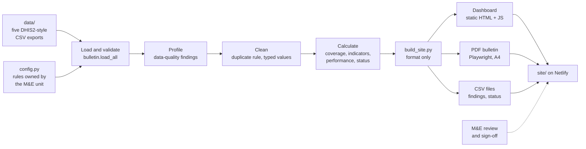
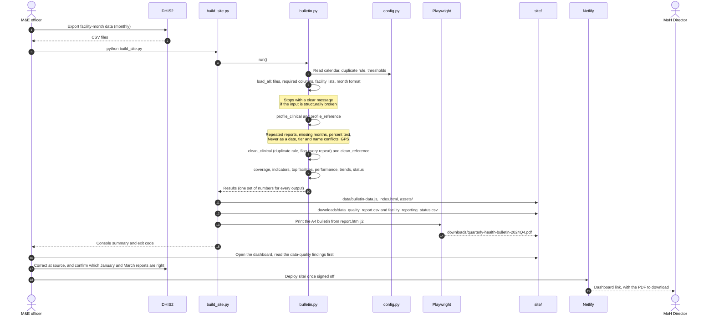

# Quarterly Health Bulletin

Automated production of Rwanda's quarterly neonatal-care bulletin from DHIS2-style facility exports, with every figure traceable to its source and qualified by how complete its data is.

**Status:** prototype on the assignment's sample data. Not an official Ministry of Health publication.
**Live:** `https://YOUR-SITE.netlify.app` (dashboard, with the PDF bulletin to download)
**Context:** Sand Forward Deployed Engineer assignment, Triumphant Babalola. The problem selection, the target design on Sand's products, the production plan and the handover are in the written submission. This document covers the system itself.

---

## 1. Summary

The Ministry's M&E unit compiles this bulletin by hand, at a cost of about 40 hours a month. The prototype replaces the compilation with one deterministic run, so the people's time shifts to the decisions that only they can make.

The first run on the sample export surfaced three problems that a hand-built bulletin would have published as fact:

| Finding | Scale | Effect if not caught |
|---|---|---|
| Two different reports for the same facility and month | 234 facility-months (Jan and Mar 2024, every facility) | Q1 totals depend on which file was opened first |
| Months missing from the export | Feb and Dec 2024, all 117 facilities | Q4 deliveries appear to fall 32%; per month they rose 1.6% |
| Brief asks for indicators the export cannot supply | Antenatal care visits, reporting timeliness | Gaps filled with estimates, or silently dropped |

The system's guarantees, all enforced in code and covered by tests:

1. **Every quarterly count carries its coverage** (months present out of months expected), and only complete quarters are compared.
2. **No silent correction.** Every data problem is reported with the affected IDs. The only transformation that changes row counts is the duplicate rule, and every row it touches is flagged in every output.
3. **One source of truth.** The dashboard, the PDF and the CSV files are formatted from a single pipeline run and cannot disagree.
4. **Deterministic.** The same inputs and settings produce the same figures and the same table order on every run.
5. **Fail closed on structural breakage.** A missing file or column, facility lists that disagree, or a malformed month stops the run with a message that says what to fix.

## 2. Quick start

Requires Python 3.10+.

```
python -m venv .venv && source .venv/bin/activate      # Windows: .venv\Scripts\activate
pip install -r requirements.txt
python -m playwright install chromium                  # only needed for the PDF
python build_site.py                                   # builds site/
python -m http.server 8000 --directory site            # preview at http://localhost:8000
python -m unittest discover tests                      # 22 tests
```

A successful build ends with `Done. The site is in site/` and exit code 0.

## 3. Architecture



| Component | Responsibility | Does not |
|---|---|---|
| `bulletin.py` | Load, validate, profile, clean and calculate. Returns plain DataFrames from `run()`. | Format output or hold business rules |
| `config.py` | The calendar, the duplicate rule and the thresholds, each marked with its owner | Contain logic |
| `build_site.py` | Turns one `run()` into the dashboard data, CSVs and PDF; builds into a staging folder and swaps it in only on success | Calculate any figure |
| `dashboard/` | Static page that renders `site/data/bulletin-data.js` as SVG charts and tables | Call any service or do arithmetic beyond display |
| `templates/report.html.j2` | The A4 bulletin layout, printed to PDF | |

### Run sequence



This is the prototype's architecture. In the target design, Symmetri replaces the CSV load, HealthOS holds the rules and checks, and the Analytics Template Toolkit replaces the static site (Part 2 of the written submission).

## 4. Design decisions

Each decision states the choice, the reason and what it costs.

**D1. Profile before calculating, and report rather than repair.**
The checks run on the raw export before any figure exists, and their findings are published next to the figures. Repairing data in code would make the bulletin look clean while hiding decisions the M&E unit has to own. *Cost:* the bulletin shows its problems openly, which needs explaining to readers on first use.

**D2. Fail closed on structure, fail open on content.**
Structural faults (missing column, facility lists that disagree) stop the run, because every later join would silently drop rows. Content faults (a negative count, a cause-of-death mismatch) are flagged and the run continues, because one bad row should be corrected at source, not block the whole bulletin. *Cost:* a flagged row can still reach a published total, so sign-off must read the findings first.

**D3. Business rules are configuration, with a named owner.**
The duplicate rule, the calendar and the thresholds live in `config.py`, each marked M&E unit or prototype. Duplicate rules are a registry (`DUPLICATE_RULES`), so the unit's chosen rule is one entry and one setting. *Cost:* the placeholder `keep_first` is visible and must be replaced before production.

**D4. Coverage is part of the number, not a footnote.**
Expected months per quarter come from the calendar, every count carries months present out of expected, and only complete quarters are marked comparable. Rates are shown for every quarter because they do not depend on how many months are present. *Cost:* fewer headline comparisons, which is the point.

**D5. Rates from pooled counts, with explicit gaps.**
Counts are summed first and rates calculated from the sums, so a facility with 10 births does not weigh the same as one with 1,000. A zero denominator produces a gap, never a zero or an infinite value. *Cost:* none in this data; noted because it is the most common bulletin error.

**D6. One run, static outputs.**
A single `run()` feeds every output, and the site is static files: no server, no database, no external calls. It is cheap to host, opens over 3G and has nothing to patch. *Cost:* no live data and no login; both arrive with the target design.

**D7. Determinism by construction.**
IDs and months are read as text, ties are broken by facility ID, and the only time-dependent value is the build timestamp. A test runs the pipeline twice and compares every table. *Cost:* none.

## 5. Data contract and quality checks

### Inputs

| File | Grain | Required columns (beyond `facility_id`) |
|---|---|---|
| `clinical_neonatal.csv` | facility × month | `reporting_month` (YYYY-MM), deliveries, births, deaths by age and cause, preterm, birth weight, Apgar |
| `facilities.csv` | facility | name, district, province, tier, GPS |
| `governance.csv` | facility | self-reported completeness, six percentage fields, protocol date |
| `healthcare_workers.csv` | facility | last training date |
| `operations.csv` | facility | (read for the facility check only) |

The exact required columns are `REQUIRED_COLUMNS` in `bulletin.py`. It is the prototype's version of the data contract described in Part 3 of the written submission.

### Checks

| Check | Outcome | Found in the sample |
|---|---|---|
| File present, required columns present, facility lists match, month is YYYY-MM | **Stop** | Pass |
| Percentage outside 0 to 100 after conversion | **Stop** | Pass |
| Same facility and month reported twice with different values | Flag, apply duplicate rule | 234 facility-months, 468 rows |
| Expected month missing | Flag | Feb and Dec 2024, all 117 facilities |
| Negative count | Flag | 0 |
| Live births exceed deliveries | Flag | 0 |
| Causes of death do not sum to total deaths | Flag | 0 |
| Percentage stored as text | Flag, convert | 6 columns |
| Never in a date field | Flag, treat as missing | 14 and 48 rows |
| Facility tier contradicts its name | Flag | 28 facilities |
| GPS more than 0.5° from the district median | Flag | 61 of 117 facilities |

## 6. Metric definitions

| Metric | Definition | Level |
|---|---|---|
| Coverage | months present ÷ months expected in the quarter | quarter |
| Stillbirth rate | stillbirths ÷ (live births + stillbirths) × 1,000 | quarter; national, province |
| Neonatal mortality | deaths 0 to 28 days ÷ live births × 1,000 (early 0 to 7, late 8 to 28) | quarter; national, province |
| Preterm, low birth weight, Apgar < 7 | count ÷ live births × 100 | quarter; national, province |
| Cause of death | deaths from cause ÷ all neonatal deaths × 100 | quarter; national |
| Top facilities | total deliveries, ties by facility ID | quarter |
| Observed completeness | months with a report ÷ 12 × 100 | facility |
| Self-reported completeness | `hmis_reporting_completeness` | facility |
| Trend | change on the previous quarter; comparable only if both quarters are complete | quarter; national |
| Reporting status | Silent: last report ≥ 2 months old. Partial: fewer reports than expected so far. Otherwise Reporting | facility |

## 7. Configuration

All in `config.py`. Settings owned by the M&E unit are placeholders until the unit confirms them.

| Setting | Current | Owner | Effect |
|---|---|---|---|
| `EXPECTED_MONTHS` | 2024-01 to 2024-12 | M&E unit | Calendar for missing months and coverage |
| `DUPLICATE_RULE` | `keep_first` | M&E unit | Which repeated report is used (`keep_first`, `keep_last`); unknown names stop the run |
| `FULL_QUARTER_SHARE` | 1.0 | M&E unit | Share of months a quarter needs to be complete and comparable |
| `SILENT_MONTHS_THRESHOLD` | 2 | M&E unit | Months without a report before a facility is Silent |
| `TOP_N` | 10 | Prototype | Length of the top facilities table |

## 8. Operations

**Build.** `python build_site.py` writes the site into `site.build/` and replaces `site/` only when the build finishes, so a failed build never leaves a half-written site.

**Deploy.** Netlify serves `site/` as static files with no build step (`netlify.toml`). Either drag the folder onto app.netlify.com/drop, or connect the repository and leave the build command empty. Rebuild before deploying whenever data or code changes. The site sends `noindex`, because it uses the Ministry's name.

**Exit codes.**

| Code | Meaning |
|---|---|
| 0 | Site and PDF built |
| 1 | Site built, PDF not (Playwright missing); do not deploy |
| 2 | Stopped by a data problem; nothing changed in `site/` |

**Troubleshooting.**

| Message | Cause | Action |
|---|---|---|
| `missing required columns: ...` | Export columns changed | Compare the header with `REQUIRED_COLUMNS`; fix the export or the mapping |
| `facility_id list in ... differs` | Files cover different facilities | Re-export all five for the same facility list |
| `Unknown DUPLICATE_RULE` | Typo in `config.py` | Use a name listed in the message |
| `PDF skipped: Playwright is not installed` | PDF dependency missing | `pip install playwright && python -m playwright install chromium` |
| Dashboard shows No data found | `site/data/bulletin-data.js` absent | Rebuild; serve from the `site` folder |

## 9. Testing strategy

```
python -m unittest discover tests
```

Two layers, so a failure points at its cause:

- **Rule tests** (`tests/test_pipeline.py`) pin each guarantee on small hand-made data: duplicate flagging and rule switching, every fail-closed condition, out-of-range percentages, zero denominators, pooled rates, coverage from the calendar, comparability, and run-to-run determinism.
- **Output checks** (`tests/test_build.py`) run on the real sample: quarters align across tables, provinces sum to the national total, causes sum to 100%, the top 10 is ordered, every facility has a status, and no NaN reaches the browser.

Not covered: agreement with figures the Ministry has already published. That is the side-by-side quarter in section 11.

## 10. Implementation notes

### Deliberate shortcuts

| Shortcut | Where | Replaced by |
|---|---|---|
| CSV files instead of a DHIS2 connection | `load_all()` | Symmetri connection to DHIS2 |
| `keep_first` duplicate rule, as a placeholder | `config.DUPLICATE_RULE`, `DUPLICATE_RULES` | The M&E unit's rule, using DHIS2 update times or approvals |
| Calendar typed in | `config.EXPECTED_MONTHS` | DHIS2 reporting periods |
| Completeness from row presence | `coverage_by_quarter()`, `metric_facility_performance()` | DHIS2 completeness data |
| Static site on Netlify instead of Superset | `build_site.py`, `dashboard/` | Analytics Template Toolkit dashboard and scheduled PDF |
| No login, schedule or audit log | | Scheduling, sign-off and audit (Part 3 of the written submission) |
| Tests check internal consistency, not published figures | `tests/` | Side-by-side quarter with the manual bulletin |

### Demo status (Week 3)

**Working:** every bulletin section from the real export, with coverage on every figure (Q4: 36,961 deliveries, stillbirth rate 28.2, neonatal mortality 49.9); data-quality findings with facility IDs; reporting status for all 117 facilities (the first piece of Problem B); a full rebuild in under a minute.

**Open:** Q1 is provisional until the repeated January and March reports are resolved; Q4 has two months; no antenatal care or timeliness data in the export; at 52 facilities self-reported and observed completeness differ by more than 10 points, and the Ministry has not chosen which to trust; the layout needs the Ministry's last published bulletin to match its format.

The demo order matters: the data-quality findings go to the M&E lead before the Director sees any number, so the caveats come from the Ministry's own team.

### Findings that shaped the design

- Profiling found every problem in one pass, before any metric. Most of the 40 hours is likely spent on these decisions, not on arithmetic, which is why D1 reports rather than repairs.
- Adding coverage to every number changed the whole bulletin layout (D4). Q4 in this export shows why.
- The brief and the export disagree on what is available. The first deliverable is a precise list of what is missing, not an estimate.
- The M&E unit will not trust a clean-up it cannot inspect, hence the flagged rows and the rule registry (D3).
- Silent-facility detection is the coverage logic applied per facility, which is why Problem B's first piece came almost free.

## 11. Path to production

Ordered by risk to the Ministry. Each is set out with its concern and remedy in Part 3 of the written submission.

1. **Export changes.** Symmetri connection to DHIS2, with every pull validated against a data contract in HealthOS. `REQUIRED_COLUMNS` is the starting point.
2. **The duplicate rule.** Chosen by the M&E unit, configured in HealthOS, every decision recorded.
3. **Reporting periods and cut-off.** Calendar from DHIS2, an agreed cut-off date, and a bulletin held back when coverage is too low.
4. **Proving the numbers.** One quarter run side by side with the manual bulletin, every difference explained, signed off by the M&E lead before the manual process stops.
5. **Running in real conditions.** Resumable runs for power cuts, scheduling through Sand's products, offline copies, SMS alerts.

## 12. Repository layout

```
bulletin.py                 pipeline: load, validate, profile, clean, calculate
build_site.py               formats one run into site/: dashboard data, CSVs, PDF
config.py                   rules and thresholds, each with its owner
dashboard/                  static dashboard source (index.html, style.css, app.js)
templates/report.html.j2    A4 bulletin layout; fonts in templates/fonts/
templates/bulletin.html.j2  plain HTML bulletin written by bulletin.py
data/                       sample exports
site/                       built site, published by Netlify
tests/                      rule tests and output checks
netlify.toml                publish site/, no build step, noindex
```
